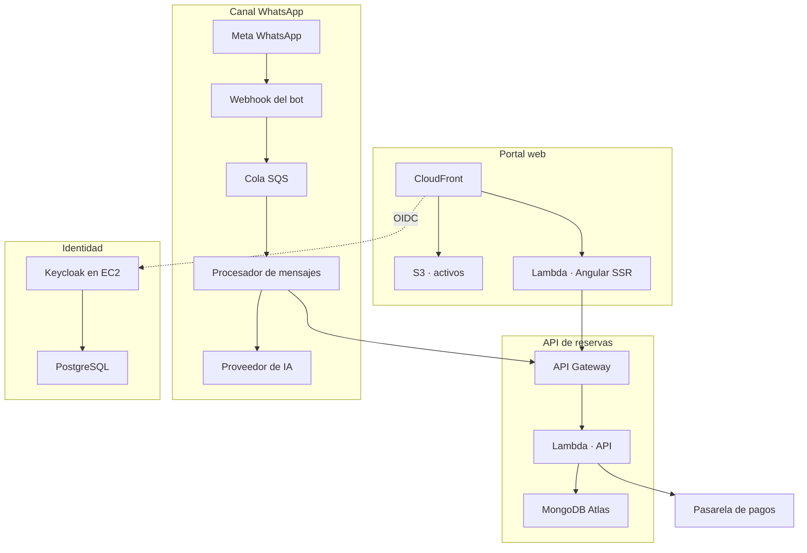
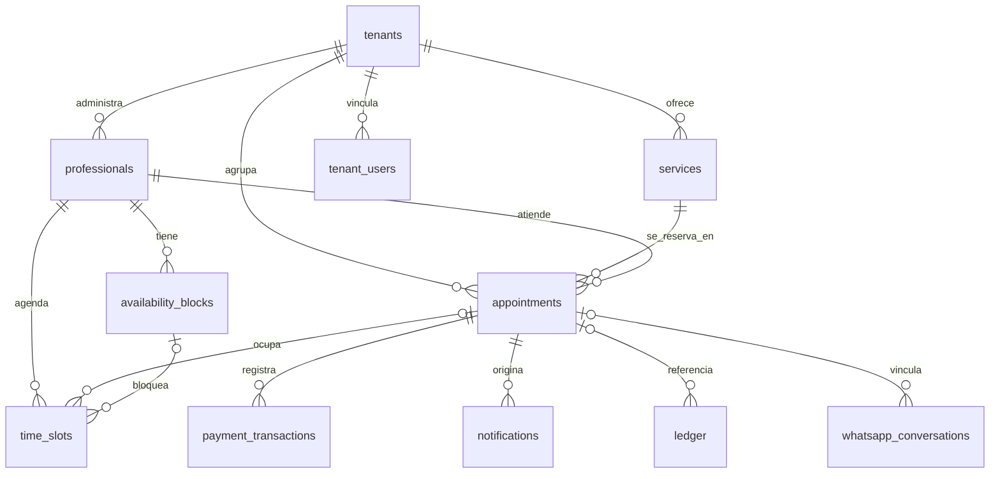
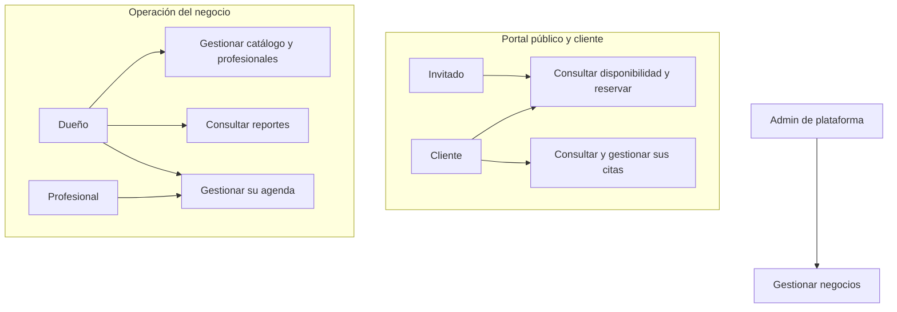
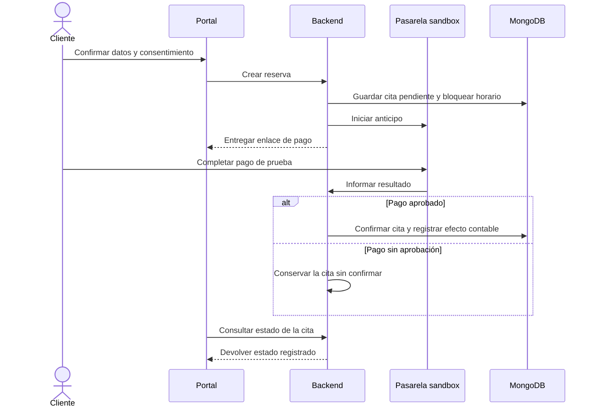
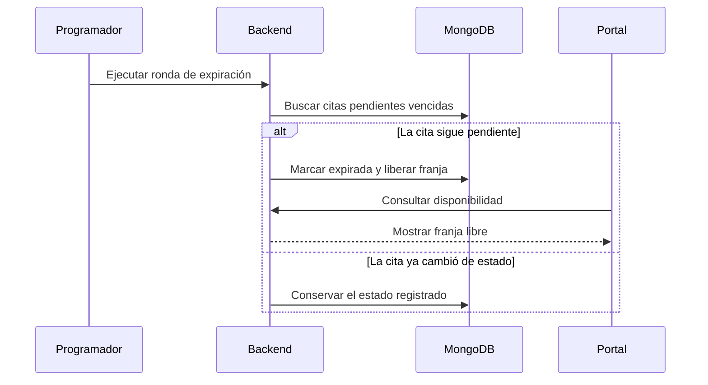
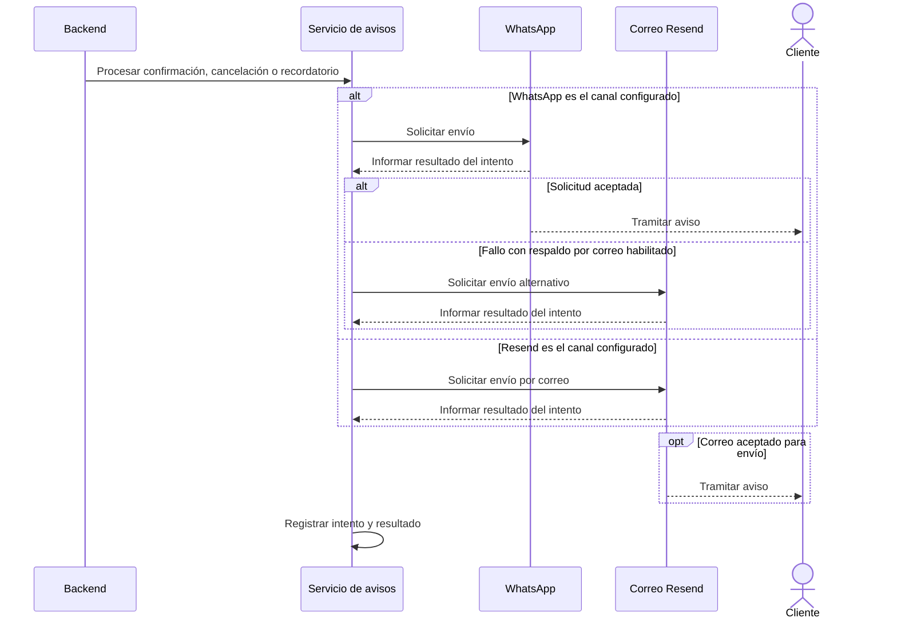

# Diagramas editables de ReservaYa

Cada diagrama tiene una fuente `.mmd` y una vista previa en Mermaid. Los diagramas describen la versión de referencia. Los resultados observados y su alcance están en el [informe de pruebas](../Pruebas/evidencia-ci.md).

## Despliegue AWS

La topología web, de Back e identidad toma como referencia el comparativo de David Galvis, página 3. El canal de reservas por WhatsApp sigue el ADR-14 y el servicio de la rama `Fernando`, que documenta la ruta Meta, SQS y Back. La versión del bot que atiende el número de la demo queda por confirmar. [ADR-14](../ADR-14-consolidacion-whatsapp-legacy-fyn.md) · [Servicio conversacional](https://github.com/DavidGV-ux/ReservaYa-Whatsapp/blob/Fernando/package.json)

## Modelo de datos MongoDB

El diagrama muestra las referencias de aplicación entre las colecciones principales. Cada franja pertenece a un profesional y puede referenciar una cita o un bloque de disponibilidad según su tipo. [Script de inicialización de MongoDB](https://github.com/DavidGV-ux/Modelo-de-datos-Reserva-Ya/blob/main/Codigo/Back/scripts/schema/setup-reservaya-atlas.js)

## Casos de uso web

El diagrama muestra los objetivos principales de cada rol en el portal y el panel. El SRS desarrolla las condiciones de acceso, consentimiento y pago. [SRS v2](../SRS/SRS-v2.md)

## Secuencia del pago del anticipo

El flujo ilustra el pago alojado en sandbox. El portal consulta el estado registrado por Back después de que Back procesa el resultado de la pasarela. La prueba de Wompi cubre el pago aprobado y la deduplicación de una aprobación reenviada. [Pruebas de pasarelas](https://github.com/DavidGV-ux/Back-Reserva-Ya/blob/870ad2438c3f3452879da0d36ba19ad0495d97ca/test/integration/payments-providers.test.ts)

## Secuencia de expiración

La configuración de referencia ejecuta el trabajo cada cinco minutos. El vencimiento de una cita depende del plazo de pago configurado. La disponibilidad se consulta después de que el trabajo libera la franja. [Configuración de Back](https://github.com/DavidGV-ux/Back-Reserva-Ya/blob/870ad2438c3f3452879da0d36ba19ad0495d97ca/serverless.yml)

## Secuencia de notificación

El resultado registrado corresponde al intento de envío. La integración de Back comprueba el respaldo por correo bajo condiciones de prueba. El canal efectivo y la recepción por el cliente se verifican en el entorno de entrega. [Prueba de notificaciones y recordatorios](https://github.com/DavidGV-ux/Back-Reserva-Ya/blob/870ad2438c3f3452879da0d36ba19ad0495d97ca/test/integration/notifications-reminders.test.ts)

## Archivos fuente

[despliegue-aws.mmd](despliegue-aws.mmd) · [modelo-mongodb.mmd](modelo-mongodb.mmd) · [casos-de-uso.mmd](casos-de-uso.mmd) · [secuencia-pago.mmd](secuencia-pago.mmd) · [secuencia-expiracion.mmd](secuencia-expiracion.mmd) · [secuencia-notificacion.mmd](secuencia-notificacion.mmd)
